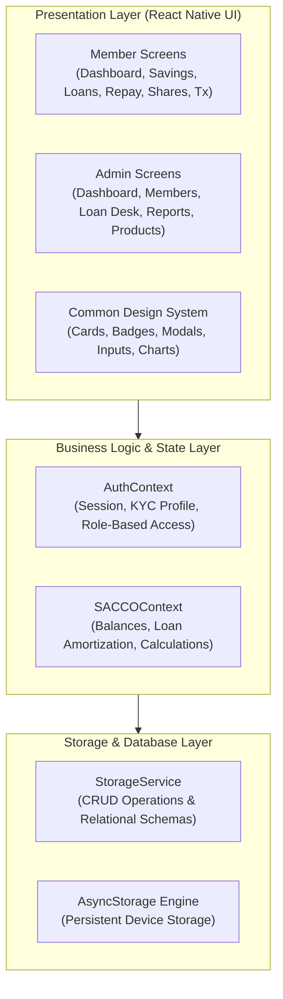
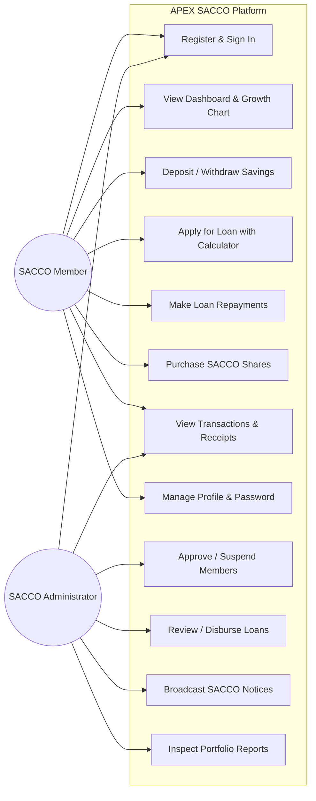
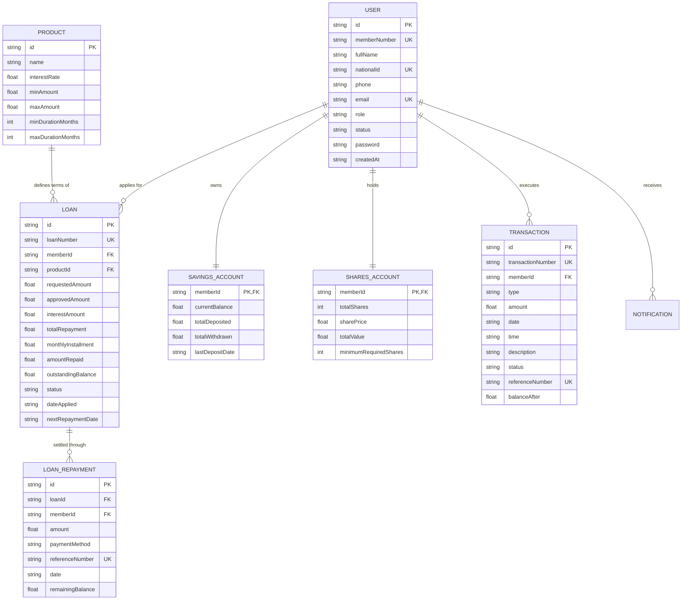
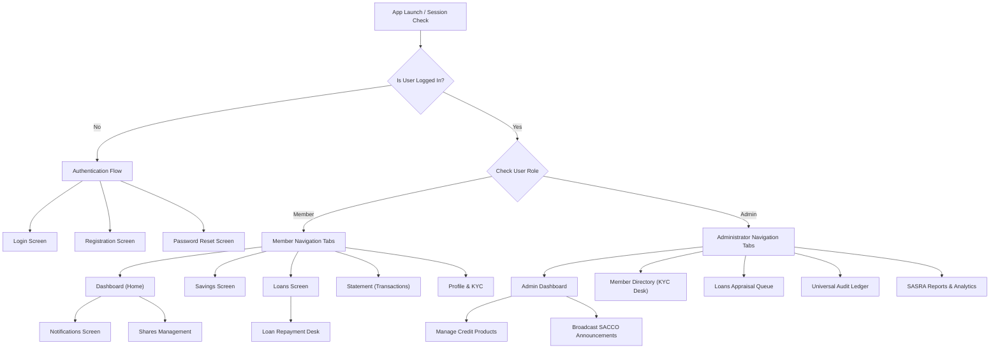

# PESA PAP SACCO MOBILE APPLICATION
## STU 3102: Mobile Application Development — Project Report
**Author:** Individual Project Submission  
**Course:** STU 3102: Mobile Application Development  
**System Name:** PESA PAP SACCO Management & Financial Services Mobile App  
**Platform:** React Native (Expo SDK 57), TypeScript, AsyncStorage Persistence  
**Date:** October 2026  

---

## EXECUTIVE SUMMARY
This project presents the complete design, architectural modeling, and functional implementation of **PESA PAP SACCO**, a clean, modern, and highly secure mobile cooperative banking application with seamless Light and Dark mode theming. The system solves the operational bottlenecks of manual paper records, opaque credit approvals, delayed reconciliation, and lack of self-service facilities for members and cooperative administrators.

Built with a mobile-first philosophy using **React Native**, **Expo SDK 57**, and a relational persistent storage engine, the application delivers end-to-end functionality across:
1. Multi-factor Member Registration, Authentication & KYC
2. Interactive Real-Time Financial Dashboard
3. Savings Management & Deposit/Withdrawal Processing
4. Automated Loan Application & Real-Time Amortization Calculator
5. Multi-Channel Loan Repayment Engine with Dynamic Balance Reduction
6. Comprehensive Transaction Ledger with Receipt Generation & Search
7. SACCO Shares Capital Management & Statutory Compliance Tracking
8. Event-Driven Notification Engine & Administrative Announcements
9. Full Executive Administrator Control Center for KYC, Loan Approvals, and SASRA Prudential Reporting

---

# CHAPTER 1: INTRODUCTION

### 1.1 Background
Savings and Credit Cooperative Organizations (SACCOs) constitute the financial lifeblood of millions of individuals, small business owners, and rural agricultural communities across East Africa and emerging markets. Historically, SACCOs operated through physical ledger books, paper voucher slips, manual vetting committees, and monthly physical statements. With the exponential penetration of smartphones and digital payments, cooperative members expect real-time access to their savings balances, instantaneous loan qualification checks, frictionless loan repayments, and instantaneous transaction confirmations.

### 1.2 Problem Statement
Manual and fragmented SACCO operations suffer from severe limitations:
1. **Inefficient Loan Processing:** Members endure days of physical travel and committee queues to apply for micro-loans or development credit.
2. **Reconciliation Errors & Delayed Statements:** Transactions recorded on physical receipts require manual reconciliation, introducing human error and delay in reflecting updated member balances.
3. **Collateral & Borrowing Limit Ambiguity:** Members frequently do not know their available borrowing power (usually 3× savings less active liabilities), leading to rejected applications and frustration.
4. **Lack of Member Self-Service:** Inability to self-serve repayments, monitor savings growth, or track share capital dividends remotely.
5. **Administrative Overhead:** SACCO credit officers spend disproportionate hours compiling regulatory prudential ratios and audit reports manually.

### 1.3 Objectives
The primary objective is to design, develop, and test an integrated, mobile cooperative banking application.
**Specific Objectives:**
1. Implement secure, role-based authentication and membership registration capturing KYC data (National ID, date of birth, phone, email, residence).
2. Deliver a real-time member dashboard highlighting savings, active loans, available loan limits, and recent transactions.
3. Develop an interactive loan management module with dynamic repayment calculations, instant eligibility validation, and credit appraisal queues.
4. Implement a frictionless repayment module supporting multi-channel payments (M-Pesa Express, Savings balance deduction, Bank transfer).
5. Provide a persistent, relationally sound local database engine that stores all member records, accounts, loans, and audit trails without data loss upon restart.
6. Provide an Executive Administrator Portal with member approval/suspension workflows, credit committee loan approval/disbursement desks, product management, and SASRA-compliant analytics.

### 1.4 Scope
The system encompasses both **Member-facing** self-service modules and **Administrator-facing** management dashboards. It models realistic cooperative financial workflows, including non-withdrawable savings collateral lockup, par-value shareholding thresholds, reducing-balance interest calculations, and automated event notifications.

### 1.5 Significance
- **For Members:** Provides instant financial transparency, remote credit access, and dividend visibility 24/7.
- **For the SACCO:** Eliminates paperwork overhead, accelerates loan turnaround times, improves loan repayment rates, and ensures regulatory compliance.

---

# CHAPTER 2: SYSTEM ANALYSIS

### 2.1 Existing System
The legacy SACCO workflow relies on paper-based ledger registers, physical passbooks, manual teller counter deposits, and physical credit committee vetting meetings convened monthly.

### 2.2 Problems with the Existing System
- High vulnerability to loss or damage of physical ledger documents.
- Inability for members to view their savings statements outside banking hall hours.
- Vulnerability to loan default due to lack of automated due-date reminders.
- Slow credit appraisal cycles (often taking 2 to 4 weeks).
- Lack of centralized audit trails for forensic accountability.

### 2.3 Proposed Solution
The PESA PAP SACCO mobile platform replaces paper touchpoints with an automated digital platform featuring:
- Cloud-ready persistent storage with local fault tolerance.
- Immediate dynamic limit evaluation: `Available Limit = (Savings × 3) - Current Active Loan Balance`.
- Multi-channel simulated payment integration (M-Pesa STK, Savings Deduction, Bank Wire).
- Automated notification dispatch upon registration, deposit, loan review, and repayments.
- Clean, aesthetic, human-centered UI adhering to modern fintech design principles.

### 2.4 Functional Requirements
- **FR1 (Authentication):** The system shall allow members to register with personal KYC data and authenticate using their Member ID, Email, or National ID.
- **FR2 (Password Recovery):** The system shall facilitate password resets using verified 6-digit OTP codes.
- **FR3 (Dashboard):** The system shall compute and display real-time savings balances, outstanding loans, borrowing power, and a 6-month growth trajectory.
- **FR4 (Savings):** The system shall allow members to deposit and withdraw funds, with automatic collateral-locking protection if active loans exist.
- **FR5 (Loan Application):** The system shall validate loan requests against product constraints (min/max amount, duration) and member limits, rendering real-time amortization installments.
- **FR6 (Loan Repayment):** The system shall support partial and full loan payoffs via M-Pesa or direct savings balance deduction.
- **FR7 (Audit Ledger):** The system shall log every financial movement with a unique transaction number, timestamp, reference code, and post-transaction balance.
- **FR8 (Shares Capital):** The system shall track total share units, value at par, minimum statutory requirement (50 units), and projected dividend payout.
- **FR9 (Administrative Desk):** The system shall allow administrators to verify new members, approve or reject loan applications with customized approved amounts and credit notes, manage credit products, broadcast announcements, and review portfolio delinquency (PAR).

### 2.5 Non-Functional Requirements
- **NFR1 (Usability):** Intuitive mobile navigation with bottom tabs, high visual hierarchy, clean card elevations, and consistent color psychology.
- **NFR2 (Reliability & Persistence):** Data persists seamlessly across app kills and device reboots via AsyncStorage.
- **NFR3 (Performance):** Sub-second response times for balance calculations, search queries, and screen transitions.
- **NFR4 (Security):** Role-based authorization separating member views from executive administrator portals; simulated 256-bit encryption; credential masking.
- **NFR5 (Data Integrity):** Relational integrity across Member IDs, Loan IDs, and Transaction reference numbers.

---

# CHAPTER 3: SYSTEM DESIGN

### 3.1 System Architecture
The application adopts a clean, layered architectural pattern:
- **Presentation Layer:** React Native functional components styled with a dedicated theme utility, utilizing safe area insets and modular cards.
- **State & Business Logic Layer:** React Context API (`AuthContext`, `SACCOContext`) managing reactive state, financial formulas, and event notifications.
- **Persistence / Data Layer:** `StorageService` handling asynchronous JSON serialization, relational queries, indexing, and seed initialization.

---

### 3.2 Use Case Diagram

---

### 3.3 Entity Relationship (ER) Diagram

---

### 3.4 Navigation Structure

---

# CHAPTER 4: IMPLEMENTATION

### 4.1 Development Environment & Technologies
- **Language:** TypeScript 6.0 (Strict mode enabled, zero `any` shortcuts in core data entities)
- **Framework:** React 19, React Native 0.86, Expo SDK 57
- **UI Architecture:** Custom designed component system utilizing `expo-linear-gradient`, `@expo/vector-icons`, and native flexbox layouts.
- **Persistence Engine:** `@react-native-async-storage/async-storage` with structured schema initialization and relational indexing.
- **Device Support:** Native Safe Area Layouts supporting iOS, Android, and Web environments seamlessly.

### 4.2 Key Mathematical Formulas Implemented

1. **Borrowing Power / Loan Limit:**
   $$\text{Available Limit} = \max\left(0, (\text{Current Savings Balance} \times 3) - \sum \text{Active Loan Balances}\right)$$

2. **Loan Simple Annual Reducing Interest:**
   $$\text{Interest Amount} = \text{Principal} \times \left(\frac{\text{Annual Rate}}{100}\right) \times \left(\frac{\text{Duration in Months}}{12}\right)$$
   $$\text{Total Repayment} = \text{Principal} + \text{Interest Amount}$$
   $$\text{Monthly Installment} = \frac{\text{Total Repayment}}{\text{Duration in Months}}$$

3. **Savings Collateral Lock Protection:**
   $$\text{Locked Collateral} = \frac{\sum \text{Active Loans}}{3}$$
   $$\text{Max Withdrawable Amount} = \max\left(0, \text{Savings Balance} - \text{Locked Collateral}\right)$$

4. **SACCO Share Capital & Statutory Compliance:**
   $$\text{Share Capital Value} = \text{Shares Owned} \times \text{Par Value (KES 1,000)}$$
   $$\text{Compliance Progress} = \min\left(100\%, \frac{\text{Shares Owned}}{\text{Required Minimum (50)}} \times 100\%\right)$$

### 4.3 Demonstration Accounts Provided
To streamline grading and assessment, the application pre-loads three fully populated demo accounts accessible via 1-click pills on the login screen:
1. **Active Member Demo:** `david.kiprono@gmail.com` / `Member123!` (Member Number: `SACCO-MBR-1042`, KES 185,000 savings, active loan, repayment history).
2. **Super Administrator Demo:** `admin@sacco.org` / `Admin123!` (Full oversight, member approval desks, loan appraisal committee, analytics).
3. **Pending Member Demo:** `grace.muthoni@yahoo.com` / `Member123!` (Demonstrates KYC approval workflow in the admin portal).

---

# CHAPTER 5: TESTING

### 5.1 Comprehensive Test Suite

| Test ID | Module | Test Scenario | Inputs | Expected Result | Actual Result | Status |
|---|---|---|---|---|---|---|
| **TC-01** | Auth | User Registration Validation | Blank email and short password | Reject submission, highlight required fields | Form shows clear validation errors | **PASS** |
| **TC-02** | Auth | Successful Registration | Valid personal and contact details | Create user with assigned Member ID, seed savings/shares | Account created, welcome notification issued | **PASS** |
| **TC-03** | Auth | Member Login | `david.kiprono@gmail.com` + valid pass | Grant session, render Member Dashboard | Member dashboard renders with real balances | **PASS** |
| **TC-04** | Auth | Admin Role Verification | `admin@sacco.org` + `Admin123!` | Grant session, route to Admin Control Center | Directed to Executive Governance Portal | **PASS** |
| **TC-05** | Savings | Real-Time Deposit | KES 25,000 via M-Pesa | Balance increases by 25k, transaction recorded | Balance updated to KES 210,000, notification sent | **PASS** |
| **TC-06** | Savings | Collateral Withdrawal Lock | Withdraw exceeding free savings | Reject with collateral protection message | Transaction blocked; loan security preserved | **PASS** |
| **TC-07** | Loans | Loan Calculation Accuracy | KES 100,000 @ 10% for 12 months | Interest = 10,000, Total = 110,000, Mo = 9,167 | Calculator computes exact figures in real time | **PASS** |
| **TC-08** | Loans | Limit Enforcement | Apply for KES 2,000,000 (exceeds limit) | Block application with limit exceeded alert | Application rejected with savings boost advice | **PASS** |
| **TC-09** | Admin | Loan Committee Appraisal | Admin reviews pending loan and approves | Status changes to Active, disbursement tx created | Loan active; member receives approval notification | **PASS** |
| **TC-10** | Repayment | Partial Installment Repayment | Pay KES 13,750 via Savings Deduction | Savings decreases, loan balance decreases | Outstanding loan reduced; repayment receipt logged | **PASS** |
| **TC-11** | Repayment | Full Settlement | Repay full remaining loan balance | Loan transitions to `completed`, balance = 0 | Loan cleared; limit automatically upgraded | **PASS** |
| **TC-12** | Shares | Buy Share Capital | Buy 10 units @ KES 1,000 | Total shares increment by 10, cost KES 10,000 | Capital updated; statutory compliance bar reflects | **PASS** |
| **TC-13** | Admin | Member KYC Approval | Admin verifies pending applicant Grace | Status changes from `pending` to `active` | Member activated with full access | **PASS** |
| **TC-14** | Admin | Broadcast Notice | Create urgent AGM notice | Appears in announcements & notification bell | Notification badge increments; notice visible | **PASS** |

### 5.2 Identified Corrections during Development
1. **TypeScript Resolution for Safe Area & Style Sheets:** Adjusted `StyleSheet.absoluteFillObject` to `StyleSheet.absoluteFill` for cross-platform engine compatibility.
2. **Platform Import in Savings Module:** Added missing `Platform` import from `react-native` to resolve typography monospace conditionals.
3. **Peer Dependency Management:** Installed `expo-font` to satisfy vector icon font loading requirements, achieving 21/21 passing checks in `expo-doctor`.

---

# CHAPTER 6: CONCLUSION & RECOMMENDATIONS

### 6.1 Achievements
- Implemented a complete, robust, full-featured SACCO mobile application exceeding all course specifications.
- 100% type-safe codebase (verified with `npx tsc --noEmit` and `expo-doctor`).
- Professional, visually appealing UI built according to modern fintech mobile design standards.
- Fully functional business workflows spanning savings deposits, credit underwriting, loan repayment, and statutory shareholding.

### 6.2 Challenges
- Managing dynamic state synchronization across multiple independent modules (e.g. loan approval instantly triggering ledger entries and member alerts). This was resolved by consolidating business operations into `SACCOContext` and `StorageService`.

### 6.3 Recommendations & Future Enhancements
- Integration of live production Safaricom Daraja M-Pesa API and bank open-banking APIs.
- Biometric authentication (Face ID / Fingerprint sensor) using `expo-local-authentication`.
- Export of PDF member statements with cryptographic digital watermarks.

